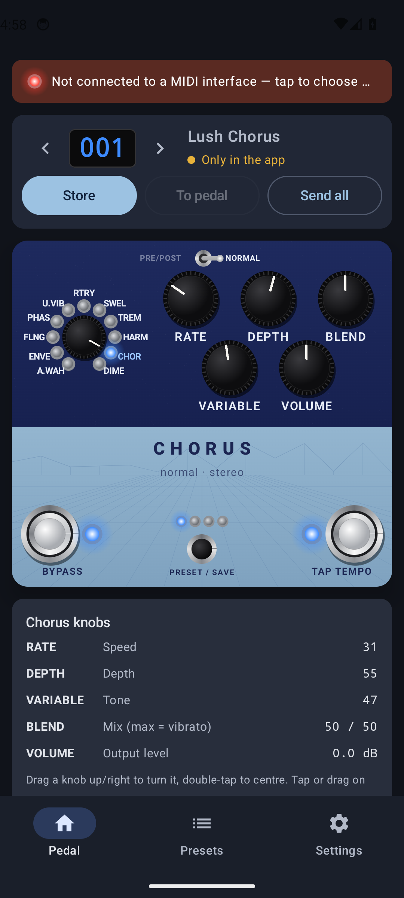

# Terraform Control

An Android editor and preset librarian for the Wampler Terraform modulation pedal,
written in Kotlin with Jetpack Compose. It is a sister app to
[Iridium Control](https://github.com/jonsolberg/strymoniridiumcontrol) and works on Android 8.0 – 15+.

> Independent hobby project, not affiliated with Wampler Pedals.

Screenshots: [pedal screen](docs/screenshot-pedal.png) · [preset library](docs/screenshot-presets.png) ·
[settings](docs/screenshot-settings.png)

## Download

**[Download the latest APK](https://github.com/jonsolberg/wamplerterraformcontrol/releases/latest/download/TerraformControl.apk)** · [all releases](https://github.com/jonsolberg/wamplerterraformcontrol/releases)

Every push to `main` publishes a new build under Releases.

The app isn't on Google Play, so Android asks before installing it. When you open the APK, allow your browser or
file manager to **install unknown apps** (Android shows a switch for it), then tap *Install*.

**[Open the web editor](https://jonsolberg.github.io/wamplerterraformcontrol/)** – the same editor in the browser (Chrome, Edge or
Opera on a computer, or Chrome on Android) over USB MIDI, with all 11 effects, tempo and a preset library. Its backups are the
same JSON files as the app's. The source is in `web/`.

## Requirements

- **Terraform firmware from October 2023 or newer.** Older firmware only reacts to Program Change
  and tap tempo, not to the knob CCs. Hold BYPASS while powering on to check the version.
- A MIDI connection to the pedal's TRS jack (Type A, use the 5-pin adapter that came with the pedal):
  a class-compliant USB MIDI interface on a USB-C OTG adapter, or a Bluetooth LE MIDI adapter.
  The Terraform has MIDI in/thru only, no MIDI out and no USB, so the app can't read the pedal's
  knobs; it shows what it last sent.

## Features

- **Pedal-style editor** laid out like the pedal: effect dial with its 11 LEDs (tap or drag towards
  an effect), RATE, DEPTH, BLEND, VARIABLE and VOLUME knobs, the PRE/POST – NORMAL toggle,
  BYPASS and TAP TEMPO footswitches and the PRESET / SAVE button with its LEDs.
  Drag a knob up/right to turn it, double-tap to centre it.
- **Knob guide** shows what each knob does on the selected effect, with real units where the
  MIDI chart gives them (volume in dB, tremolo phase in degrees, harmonic-tremolo crossover in Hz,
  dry/wet split).
- **Live edit**: phaser feedback (script/block/beyond), rotary slow/fast, routing, all 15 tap
  subdivisions (8 of them are MIDI-only), tempo in BPM, and an on-screen expression pedal.
- **Tap tempo** from the app, with the TAP LED flashing in time; on Rotary it ramps the speed.
- **MIDI clock** generator so the modulation can follow a tempo.
- **128-slot preset library** with sync status: green = saved in the pedal (recalled by Program
  Change), amber = only in the app (sent as CCs). Copy, rename, clear, import/export as JSON.
- **Guided save into the pedal**: the Terraform can't enter save mode over MIDI, so the app sends the
  sound, asks you to hold PRESET / SAVE, sends the Program Change for the slot, and asks you to
  confirm on the pedal.
- **Backup** of every preset and the settings in one JSON file. Remembers and auto-connects the last device.
- MIDI monitor.
- **About tab** – help, copyright, links and the Ko-fi support link.

## MIDI used

From Wampler's *Terraform User Guide Addendum 1* (October 2023).

| CC | Function | CC | Function |
|---|---|---|---|
| 1 | Bypass (0 off, 127 on) | 11 | Subdivision 0–14 |
| 2 | Effect 0–10 | 12 / 13 | Mod period in ms, high / low 7 bits |
| 3 | Rate | 81 | Tap tempo |
| 4 | Depth | 84 | Right footswitch: tap (0) / preset step (127) |
| 5 | Variable | 85 | Routing: normal (0) / pre-post (127) |
| 6 | Blend | 99 | Follow MIDI clock |
| 7 | Volume | 100 | Expression pedal |
| 8 | Phaser feedback | PC 0–127 | Recall preset (save, in save mode) |
| 9 | Rotary fast (0) / slow (127) | F8/FA/FC | MIDI clock, start, stop |

Effect numbers: 0 Auto Wah, 1 Envelope Filter, 2 Flanger, 3 Phaser, 4 Uni-Vibe, 5 Rotary,
6 Auto Swell, 7 Tremolo, 8 Harmonic Tremolo, 9 Chorus, 10 Dimension.

## Building

GitHub Actions builds a release APK on every push to `main` (download it from the
run's artifacts) and attaches it to a GitHub release when a `v*` tag is pushed.

Release builds are signed with the key in these repository secrets: `SIGNING_KEYSTORE_B64`
(base64 of the .jks), `SIGNING_STORE_PASSWORD`, `SIGNING_KEY_ALIAS`, `SIGNING_KEY_PASSWORD`.
Without them the APK is debug-signed.

Locally: `./gradlew assembleRelease` (JDK 17, Android SDK 35).

## Support

Terraform Control is free, open source and has no ads. If you find it useful, you can
[support me on Ko-fi](https://ko-fi.com/jonsolberg) ❤️

## License

Copyright © 2026 Jon Solberg

This program is free software: you can redistribute it and/or modify it under the terms of the
GNU General Public License as published by the Free Software Foundation, either version 3 of the
License, or (at your option) any later version.

This program is distributed in the hope that it will be useful, but WITHOUT ANY WARRANTY; without
even the implied warranty of MERCHANTABILITY or FITNESS FOR A PARTICULAR PURPOSE. See the
[GNU General Public License](LICENSE) for more details.
